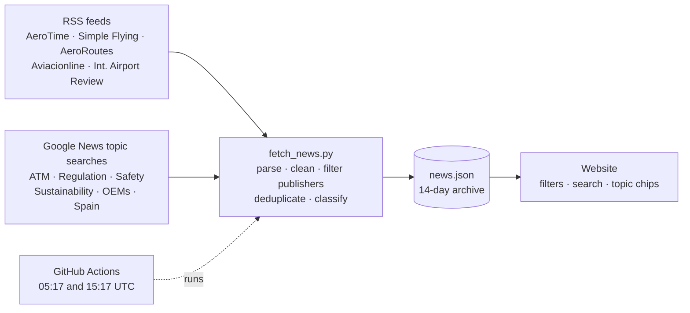

# DataPilot — Aviation Analytics

**Live site → [gonzalomg-stack.github.io](https://gonzalomg-stack.github.io)**

DataPilot is an aviation analytics portfolio that combines two things: a daily industry briefing that updates itself, and interactive Power BI dashboards built on open European air traffic data.

It is built and maintained by Gonzalo Muñoz García, a Business Analytics graduate currently completing ATPL(A) commercial pilot training.

---

## Daily aviation briefing

Every day, a Python script collects headlines from aviation publishers and topic searches, cleans them, files each one by topic and publishes the result to the site. No server and no database: GitHub Actions runs the pipeline on a schedule and the static site reads the output.



**What the script does**

- Reads RSS and Atom feeds using only the Python standard library (no dependencies)
- Strips HTML, boilerplate and duplicated headlines, including near-duplicates across publishers
- Filters out low-quality and off-topic publishers from search results
- Classifies every story into one of nine topics (ATM & Airspace, Airlines, Airports, Routes, Manufacturers, Safety, Regulation, Sustainability, Industry) with keyword rules
- Keeps a rolling 14-day archive and never fails the run if a single source is down

## Dashboards

| Dashboard | Status | Data |
|---|---|---|
| **ATFM Delays** — en-route delay by air navigation service provider, 2011–2026 | Live | EUROCONTROL |
| **CO₂ Emissions** — gate-to-gate emissions by state and market segment | In development | EUROCONTROL |
| **Traffic Recovery** — daily IFR movements against the 2019 baseline | Planned | EUROCONTROL |
| **Spanish Airports** — passengers, operations and seasonality across the Aena network | Planned | AENA |

The ATFM Delays report covers 45 ANSPs and 470 million flights, with a 2018–19 peak, the 2020 collapse and a new record in 2024.

## Tech stack

`Power BI` `DAX` `Python` `GitHub Actions` `HTML` `CSS` `JavaScript` `GitHub Pages`

## Repository

```
index.html          Site structure and content
style.css           Design system (light and dark themes)
app.js              Briefing rendering, filters, search, Power BI embed
fetch_news.py       News pipeline
news.json           Pipeline output, rewritten by the bot
.github/workflows/  Scheduled pipeline
```

Run locally:

```bash
python fetch_news.py
python -m http.server 8000   # open http://localhost:8000
```

## Data and attribution

Dashboard data: EUROCONTROL Aviation Intelligence Portal. Headlines and excerpts belong to their publishers and every story links to the original article.

## Contact

[LinkedIn](https://www.linkedin.com/in/gonzalomunozgarc%C3%ADa/) · [DataPilot](https://gonzalomg-stack.github.io)
## Probar en local

```
python scripts/fetch_news.py
python -m http.server 8000     # y abre http://localhost:8000
```
